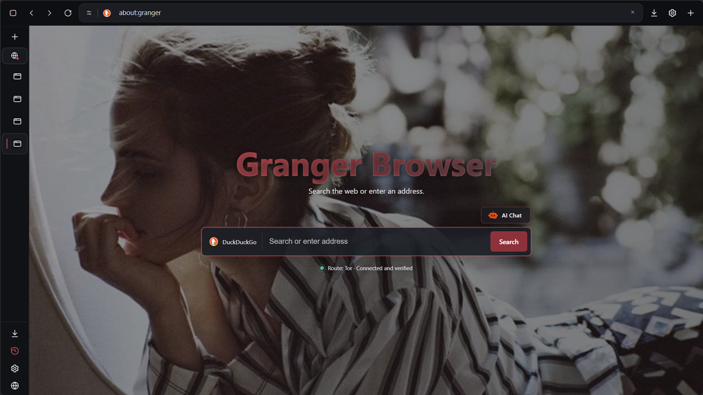
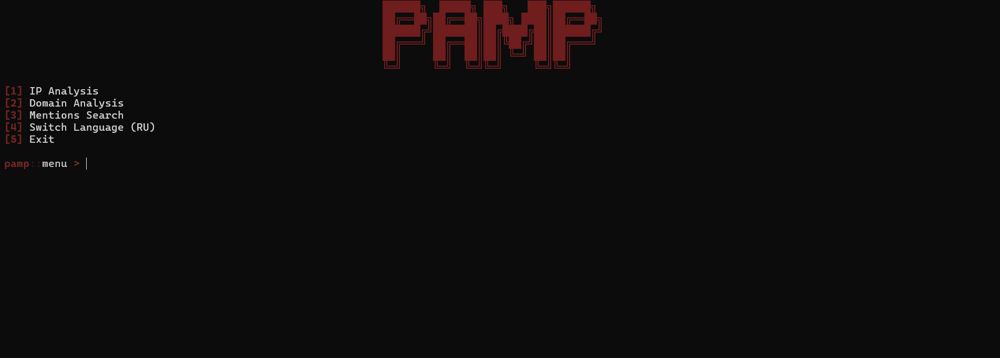
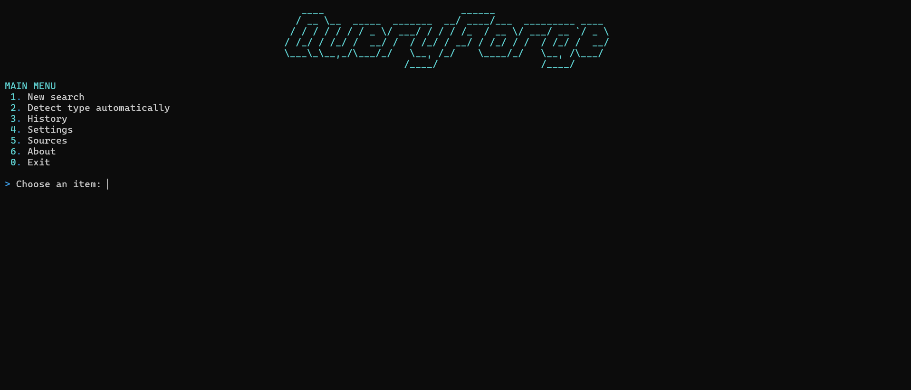
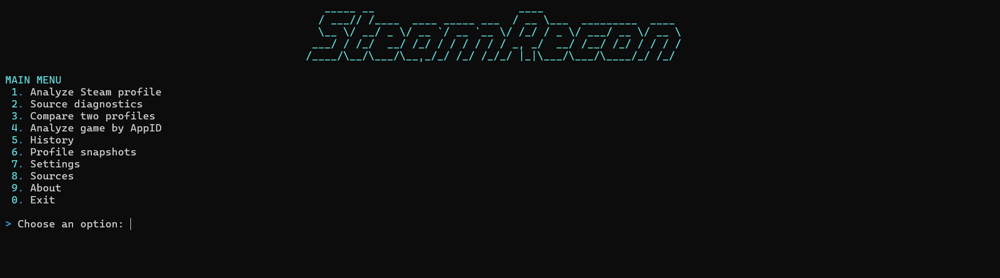

&#x20; 

&#x20; <a href="https://t.me/solvnox">

&#x20;   

&#x20; </a>

&#x20; <a href="https://t.me/solvnox\_project">

&#x20;   

&#x20; </a>

&#x20; <a href="https://www.tiktok.com/@solvnox">

&#x20;   

&#x20; </a>

 

\## About

Разработчик и основатель \*\*\[solvnox project](https://t.me/solvnox\_project)\*\*.

Занимаюсь OSINT, исследованием открытых источников и цифровых следов. Пишу методические материалы и статьи, разбираю инструменты и подходы к исследованиям, а также разрабатываю собственные OSINT-инструменты и pet-проекты.

&#x20; <code>OSINT</code>

&#x20; \&nbsp;·\&nbsp;

&#x20; <code>SOCMINT</code>

&#x20; \&nbsp;·\&nbsp;

&#x20; <code>HUMINT</code>

&#x20; \&nbsp;·\&nbsp;

&#x20; <code>Crypto-OSINT</code>

&#x20; \&nbsp;·\&nbsp;

&#x20; <code>OPSEC</code>

 

\## Featured Projects

<h2 align="center">

&#x20; <a href="https://github.com/zakhar-git/Gansar">GANSAR</a>

</h2>

&#x20; <b>Crypto Intelligence \& Blockchain Analysis</b>

&#x20; <a href="https://github.com/zakhar-git/Gansar">

&#x20;   

&#x20; </a>

GANSAR — локальный Crypto-OSINT инструмент для исследования блокчейн-адресов.

Поддерживает \*\*TON, TRON, Ethereum, BNB Chain, Bitcoin, Solana и Dogecoin\*\*. Собирает публичные on-chain данные, анализирует транзакции, контрагентов, активы и поведение адресов, строит \*\*2D и 3D investigation graphs\*\* и формирует HTML/PDF dossiers.

&#x20; <a href="https://github.com/zakhar-git/Gansar">

&#x20;   

&#x20; </a>

&#x20; <a href="https://github.com/zakhar-git/Gansar/stargazers">

&#x20;   

&#x20; </a>

 

<h2 align="center">

&#x20; <a href="https://github.com/zakhar-git/Granger-Browser">Granger Browser</a>

</h2>

&#x20; <b>Privacy-focused Browser · Tor · I2P · Isolated Spaces</b>

&#x20; <a href="https://github.com/zakhar-git/Granger-Browser">

&#x20;   

&#x20; </a>

\*\*Granger Browser\*\* — нативный privacy-oriented браузер на \*\*C++20, Qt 6 и Chromium\*\*.

Интегрирует управляемые \*\*Tor и I2P\*\*, изолированные browsing environments, собственные privacy controls и content filtering. Позволяет отдельно управлять WebRTC, Canvas, WebGL, cookies, storage, JavaScript, permissions и другими поверхностями браузера.

&#x20; 

&#x20; 

&#x20; 

&#x20; 

&#x20; <a href="https://github.com/zakhar-git/Granger-Browser">

&#x20;   

&#x20; </a>

 

\## More Projects

<table>

<tr>

<td width="50%" valign="top">

&#x20; <a href="https://github.com/zakhar-git/Pamp">

&#x20;   

&#x20; </a>

<h3 align="center">

&#x20; <a href="https://github.com/zakhar-git/Pamp">Pamp</a>

</h3>

<b>Attack Surface Intelligence</b>

Платформа для исследования внешней поверхности веб-приложений и инфраструктуры.

Анализирует IP, DNS, RDAP, TLS и HTTP, выполняет application mapping, обнаруживает маршруты, JavaScript и API endpoints и создаёт интерактивные offline HTML-отчёты.

&#x20; <a href="https://github.com/zakhar-git/Pamp">

&#x20;   

&#x20; </a>

</td>

<td width="50%" valign="top">

&#x20; <a href="https://github.com/zakhar-git/QueryForge">

&#x20;   

&#x20; </a>

<h3 align="center">

&#x20; <a href="https://github.com/zakhar-git/QueryForge">QueryForge</a>

</h3>

<b>OSINT Query Generation</b>

Локальный инструмент для построения структурированных OSINT-планов поиска по username, email, IP, доменам, компаниям и другим известным значениям.

Использует расширяемые \*\*YAML-каталоги источников и сущностей\*\*.

&#x20; <a href="https://github.com/zakhar-git/QueryForge">

&#x20;   

&#x20; </a>

</td>

</tr>

<tr>

<td width="50%" valign="top">

&#x20; <a href="https://github.com/zakhar-git/Steam-Recon">

&#x20;   

&#x20; </a>

<h3 align="center">

&#x20; <a href="https://github.com/zakhar-git/Steam-Recon">SteamRecon</a>

</h3>

<b>Steam Intelligence</b>

Инструмент для сбора и анализа публичной информации Steam-профилей.

Работает с профилями, друзьями, играми, инвентарями, aliases, avatar history, competitive-сервисами и локальными snapshots.

&#x20; <a href="https://github.com/zakhar-git/Steam-Recon">

&#x20;   

&#x20; </a>

</td>

<td width="50%" valign="top">

<h3 align="center">

&#x20; <a href="https://github.com/zakhar-git/OSINT-Toolkit">OSINT Toolkit</a>

</h3>

<b>OSINT Knowledge Base</b>

Курируемая база инструментов, методик и воспроизводимых workflows для \*\*OSINT, HUMINT, SOCMINT, GEOINT, OPSEC и digital investigations\*\*.

Фокус проекта — актуальность, практическая применимость инструментов, их ограничения и воспроизводимость исследований.

&#x20; <a href="https://github.com/zakhar-git/OSINT-Toolkit">

&#x20;   

&#x20; </a>

</td>

</tr>

</table>

 

\## Tech Stack

&#x20; 

&#x20; \&nbsp;\&nbsp;

&#x20; 

&#x20; \&nbsp;\&nbsp;

&#x20; 

&#x20; \&nbsp;\&nbsp;

&#x20; 

&#x20; \&nbsp;\&nbsp;

&#x20; 

&#x20; \&nbsp;\&nbsp;

&#x20; 

&#x20; \&nbsp;\&nbsp;

&#x20; 

&#x20; \&nbsp;\&nbsp;

&#x20; 

&#x20; \&nbsp;\&nbsp;

&#x20; 

 

\## GitHub Activity

&#x20; 

&#x20; 

&#x20; 

 

\## Contact

&#x20; <a href="https://t.me/solvnox">

&#x20;   

&#x20; </a>

&#x20; <a href="https://t.me/solvnox\_project">

&#x20;   

&#x20; </a>

&#x20; <a href="https://www.tiktok.com/@solvnox">

&#x20;   

&#x20; </a>

